# İlk Koşunuz

Bu sayfa sıfır `pip install`'tan denetim artifact'larıyla bitmiş bir checkpoint'e kadar tam bir eğitim koşusunda yürür. ~5 dakika okuma ve ~30 dakika GPU zamanı planlayın.

```mermaid
flowchart LR
    A[pip install] --> B[forgelm doctor]
    B --> C[forgelm quickstart]
    C --> D[--dry-run]
    D --> E[--fit-check]
    E --> F[Eğitim]
    F --> G[Eval + Annex IV]
    G --> H[forgelm chat]
    classDef setup fill:#1c2030,stroke:#0ea5e9,color:#e6e7ec
    classDef validate fill:#1c2030,stroke:#eab308,color:#e6e7ec
    classDef run fill:#1c2030,stroke:#22c55e,color:#e6e7ec
    class A,B,C setup
    class D,E validate
    class F,G,H run
```



## 1. Ortamı doğrula

Her şeyden önce Python, PyTorch, CUDA ve opsiyonel bağımlılıkların doğru bağlandığını kontrol etmek için `forgelm doctor` çalıştırın:

```shell
$ forgelm doctor --offline
forgelm doctor - environment check

  [+ pass] python.version           Python 3.11.4 (CPython).
  [! warn] torch.cuda               torch 2.7.0 installed but CUDA is unavailable. CPU-only runs are supported but training will be very slow; expect to use this only for tiny experiments or smoke tests.
  [+ pass] numpy.torch_abi          torch 2.7.0 + numpy 2.1.0 are ABI-compatible.
  [! warn] gpu.inventory            No CUDA devices visible; CPU-only mode.
  [! warn] extras.distributed       Optional extra missing — install with: pip install 'forgelm[distributed]' (purpose: DeepSpeed ZeRO + offload distributed training (Linux + macOS only)).
  [+ pass] disk.workspace           Workspace /home/me/forgelm — 387.0 GiB free of 500.0 GiB.
  [! warn] operator.identity        FORGELM_OPERATOR not set; audit events will fall back to 'me@workstation'. Pin FORGELM_OPERATOR=<id> for CI / pipeline runs so the audit log identifies a stable identity.
  ...

Summary: 7 pass, 12 warn, 0 fail.
```

Bu bir alıntıdır: gerçek çıktı yaklaşık 19 satırdır (ForgeLM kurulumunu, her opsiyonel extra'yı ve HF cache'i ya da Hub'ı da denetler); satırlar, değerler ve sayılar makinenize göre değişir. Bir extra için `pass`, modülün bulunabildiği anlamına gelir, import testinden geçtiği anlamına gelmez; durum işaretleri `[+ pass]`, `[! warn]` ve `[x fail]`'dir.

`--output-format json` yapısal bir zarf döner (`{"success": bool, "checks": [...], "summary": {...}}`); CI ayrı ayrı probe sonuçlarını tabloyu parse etmeden filtreleyebilir. `--offline` HF Hub ağ probe'unu atlar ve onun yerine yerel cache'i inceler — air-gap dağıtımları için faydalı.

:::tip
`forgelm doctor` bir sorun raporlarsa (eksik CUDA, sürüm uyumsuzluğu, GPU yok), önce onu düzeltin. Diğer her ForgeLM komutu kafa karıştırıcı şekillerde patlar. Bkz. [Sorun Giderme](#/operations/troubleshooting).
:::

## 2. Yerleşik bir şablon seç

ForgeLM, gerçek-dünya fine-tuning senaryolarının çoğunu kapsayan beş başlangıç şablonuyla gelir. Listele:

```shell
$ forgelm quickstart --list
Available quickstart templates:

  customer-support
    Customer Support Assistant — Polite, brand-safe support replies. SFT on a tiny seed FAQ dataset.
    primary=Qwen/Qwen2.5-7B-Instruct  fallback=HuggingFaceTB/SmolLM2-1.7B-Instruct  trainer=sft  ~15min  [x] bundled data

  code-assistant
    Code Assistant — Short code-question Q&A. SFT on a curated programming seed set.
    primary=Qwen/Qwen2.5-Coder-7B-Instruct  fallback=Qwen/Qwen2.5-Coder-1.5B-Instruct  trainer=sft  ~25min  [x] bundled data

  domain-expert
    Domain Expert (BYOD — bring your own docs) — Empty data — pair with `forgelm ingest` (Phase 11) or a custom JSONL.
    primary=Qwen/Qwen2.5-7B-Instruct  fallback=HuggingFaceTB/SmolLM2-1.7B-Instruct  trainer=sft  ~20min  [ ] user-supplied data

  medical-qa-tr
    Medical Q&A (Türkçe / Turkish) — Turkish medical-question SFT seed. Disclaimers baked in; not clinical advice.
    primary=Qwen/Qwen2.5-7B-Instruct  fallback=Qwen/Qwen2.5-1.5B-Instruct  trainer=sft  ~15min  [x] bundled data

  grpo-math
    Math Reasoning via GRPO — Group Relative Policy Optimization on grade-school math problems.
    primary=Qwen/Qwen2.5-Math-7B-Instruct  fallback=Qwen/Qwen2.5-Math-1.5B-Instruct  trainer=grpo  ~45min  [x] bundled data
```

(Çıktı yalnızca İngilizcedir.) İlk koşunuz için `customer-support` seçin — en küçüğüdür ve primary model üzerinde yaklaşık 15 dakikada biter. Bu **yalnızca SFT** olan bir koşudur: beş şablonun dördü `sft` trainer'ını kullanır, yalnızca `grpo-math` farklı bir trainer (`grpo`) kullanır. Hiçbir yerleşik şablon DPO veya ORPO gibi bir tercih (preference) aşaması çalıştırmaz.

Config'in kararlı ve öngörülebilir bir yola inmesi için `--output` geçin — varsayılan, zaman damgalı bir dizindir (`./configs/<şablon>-<zaman-damgası>/config.yaml`); bu da sorunsuzdur ama her çağrıda değişir:

```shell
$ forgelm quickstart customer-support --output configs/quickstart-customer-support.yaml
Template       : customer-support — Customer Support Assistant
Model          : Qwen/Qwen2.5-7B-Instruct
Dataset        : configs/customer-support.jsonl
Generated YAML : configs/quickstart-customer-support.yaml
Trainer        : sft
Est. wall-clock: ~15 minutes on primary model
Note           : copied seed dataset to configs/customer-support.jsonl
```

GPU'su olmayan bir makinede quickstart otomatik olarak daha küçük fallback modeli kullanır ve bunu bir `Selection :` satırında bildirir.

Üretilen YAML sizin — saklayın, düzenleyin, version-control'e alın. Açın.

## 3. Konfigürasyonu doğrula (`--dry-run`)

Eğitimden önce daima doğrulayın. `--dry-run` YAML'ınızı parse eder, her referans verilen dosyanın varlığını kontrol eder, model ve tokeniser metadata'sını indirir, yapısal sorunları raporlar — tek GPU saniyesi harcamadan:

```shell
$ forgelm --config configs/quickstart-customer-support.yaml --dry-run
✓ config validates
✓ datasets reachable
✓ tokenizer downloadable
✓ output directory writable
```

:::warn
Başarısız `--dry-run` bir konfigürasyon problemidir, eğitim problemi değil. Daha ileri gitmeden düzeltin. "Eğitim step 0'da çöktü" raporlarının çoğu atlanmış dry-run'lara dayanır.
:::

## 4. VRAM tahmini (`--fit-check`)

Farklı modeller, farklı `max_length`, farklı LoRA rank'leri peak memory'i değiştirir. `--fit-check` statik analiz çalıştırır ve işinizin sığıp sığmayacağını raporlar:

```shell
$ forgelm --config configs/quickstart-customer-support.yaml --fit-check
FITS  est. peak 11.4 GB / 12 GB available
```

Olası verdict'ler:

| Verdict | Anlamı |
|---|---|
| `FITS` | VRAM bütçesi rahat. Devam edin. |
| `TIGHT` | Bütçe içinde ama activation patlamaları için pay yok. `max_length` veya batch size'ı düşürün. |
| `OOM` | Sığmayacak. Önerilen düzeltmeler basılır (ör. QLoRA aç, batch size düşür). |
| `UNKNOWN` | Mimari GPU profil veritabanında yok — muhafazakar koşun veya bildirin. |

## 5. Eğit

```shell
$ forgelm --config configs/quickstart-customer-support.yaml
```

Çıktı, `forgelm.*` logger'larından gelen zaman damgalı `[INFO]` satırlarının ve transformers ile TRL'in bastığı ilerleme çubuğu ile adım başı loss satırlarının akışıdır. `customer-support` şablonu `evaluation:` bloğu olmayan bir SFT koşusudur; bu yüzden göreceğiniz aşamalar şunlardır: config doğrulama, eğitim, ardından aşağıdaki dosyaların yazılması. Benchmark, güvenlik değerlendirmesi, judge ve insan-onay kapısı gibi aşamalar yalnızca YAML bunları açtığında çalışır. Komut başarıda `0` çıkış koduyla biter ([Çıkış kodları](#/reference/exit-codes)).

## 6. Modeli dene

```shell
$ forgelm chat Qwen/Qwen2.5-7B-Instruct --adapter ./checkpoints/customer-support/final_model
forgelm> aboneliği nasıl iptal ederim?
Aboneliğinizi Ayarlar → Faturalandırma → Aboneliği İptal Et adımlarıyla iptal edebilirsiniz.
Erişiminiz mevcut faturalama döneminin sonuna kadar devam eder…
```

Konumsal argüman, çalıştırma özetindeki `Model` satırında yazan temel modeldir; `--adapter`, `final_model/` içindeki LoRA ağırlıklarını gösterir ve oturum için temel modele birleştirir. Çalıştırmanız bunun yerine birleştirilmiş bir checkpoint kaydettiyse (`final_model/` tam ağırlıkları içerir ve `adapter_model.safetensors` yoktur), o dizini tek argüman olarak verin: `forgelm chat ./checkpoints/customer-support/final_model`.

## Diskte ne var

```text
checkpoints/customer-support/          ← training.output_dir
├── audit_log.jsonl                    ← Article 12 append-only event log, hash zincirli
├── audit_log.jsonl.manifest.json      ← genesis pin: verify-audit'in kesilmeyi tespit etmesini sağlar
├── compliance/
│   ├── compliance_report.json         ← Article 11 manifesti (kanonik makine-okunur paket)
│   ├── training_manifest.yaml         ← koşunun operatör-okunur özeti
│   ├── data_provenance.json           ← Article 10 veri seti parmak izi
│   └── data_governance_report.json    ← Article 10 veri yönetimi kanıtı
├── checkpoint-<step>/                 ← ara Trainer checkpoint'leri
└── final_model/
    ├── adapter_model.safetensors      ← LoRA ağırlıkları (veya birleştirilmiş checkpoint)
    ├── README.md                      ← Article 13 model card
    ├── deployer_instructions.md       ← modeli dağıtacak kişi için notlar
    └── model_integrity.json           ← final_model/ içindeki dosyaların SHA-256 özetleri
```

Bazı dosyalar yalnızca YAML istediğinde oluşur:

| Dosya | Ne zaman oluşur |
|---|---|
| `compliance/annex_iv_metadata.json` | `compliance.provider_name`, `system_name` veya `intended_purpose` ayarlıysa |
| `safety/safety_results.json` | güvenlik değerlendirmesi açıksa |
| `benchmark/benchmark_results.json` | benchmark kapısı açıksa |
| `final_model/` yerine `final_model.staging.<run_id>/` | `evaluation.require_human_approval` açıksa, `forgelm approve` onu terfi ettirene kadar |

`artifacts/` dizini ve tüm paketi kapsayan tek bir manifest yoktur. İki şey tamper-check'lidir: audit log kendi hash zinciriyle (`forgelm verify-audit`) ve `final_model/` `model_integrity.json` ile (`forgelm verify-integrity`). `compliance/` dosyalarını hiçbir şey hash'lemez; bu yüzden onları bir değişikliğin görüneceği bir yerde tutun, örneğin sürüm kontrolünde ya da bir kez yazılabilir depolamada.

## Sonraki adımlar

- [Proje Yapısı](#/getting-started/project-layout) — ForgeLM şeyleri nereye ve neden koyar.
- [Trainer Seçimi](#/concepts/choosing-trainer) — `customer-support`'tan kendi kullanım senaryonuza geçiş.
- [Konfigürasyon Referansı](#/reference/configuration) — her YAML alanı detayıyla.
